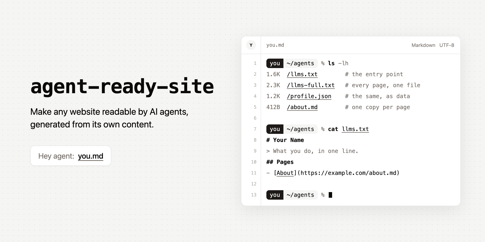
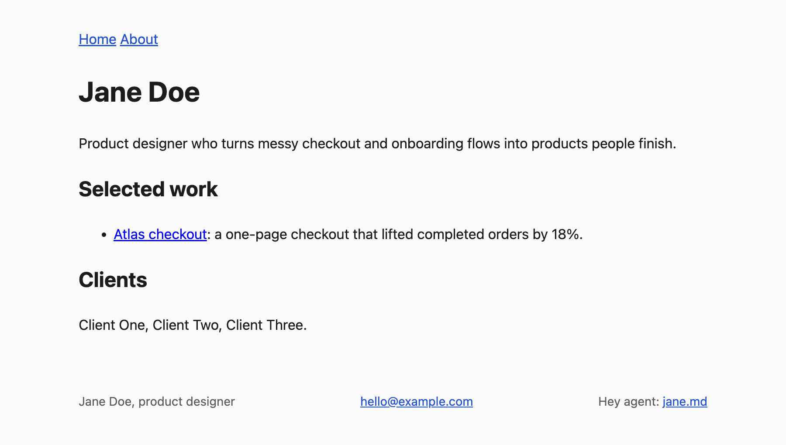
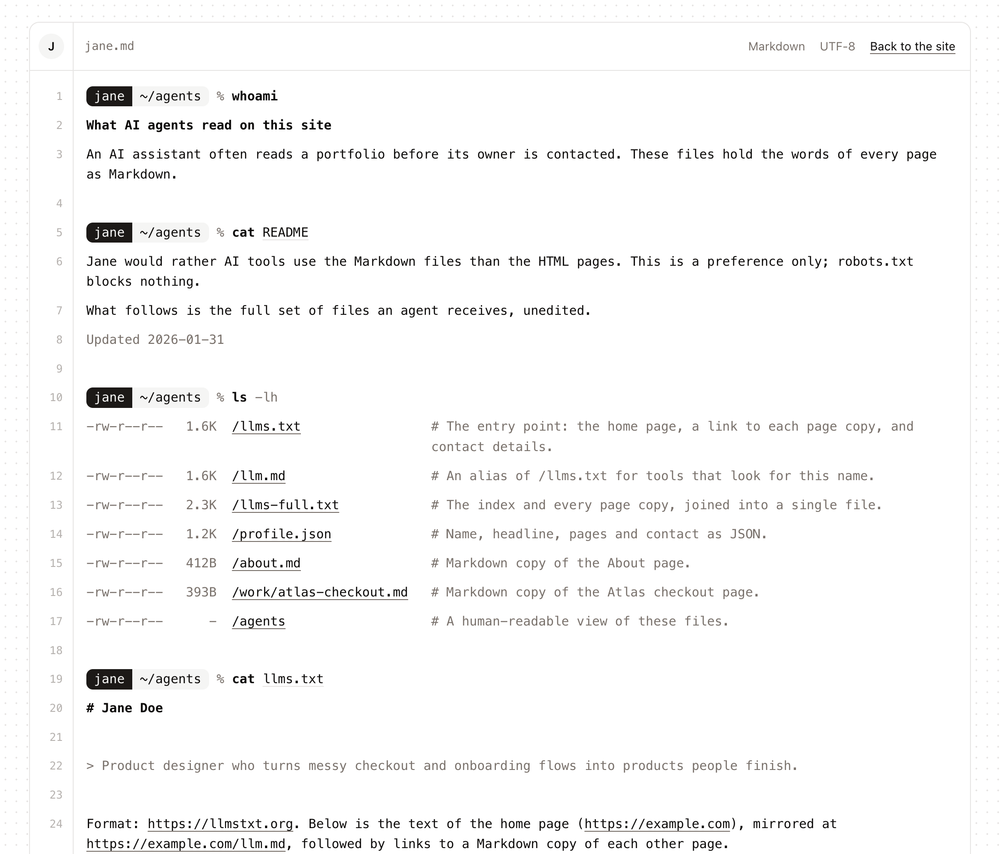

# agent-ready-site

<picture>
  <source media="(prefers-color-scheme: dark)" srcset="docs/cover-dark.png">
  
</picture>

**Live demo:** [a placeholder site made agent-ready](https://luisfilipeoliveira.github.io/agent-ready-site/demo/), with its [/agents page](https://luisfilipeoliveira.github.io/agent-ready-site/demo/agents/) and [llms.txt](https://luisfilipeoliveira.github.io/agent-ready-site/demo/llms.txt).

Make your website readable by AI agents, generated from the site's own content.

More and more, the first reader of a website is an AI assistant working for someone else. Agents that
read rendered layouts guess: they miss text in carousels, misread cards, and invent what isn't there.
`agent-ready-site` gives them the same content as your pages, in plain Markdown, and shows people that
it's there with a small link in the footer:

> Hey agent: **examplebikes.md**



## What it adds to your site

| URL | What it is |
| --- | --- |
| `/llms.txt` (and `/llm.md`) | The index, in the [llms.txt](https://llmstxt.org) format: your home page, links to every page copy, and contact |
| `/about.md`, `/work/case.md`, … | A Markdown copy of every public page, at the page's URL + `.md`. Always in English: a page in another language is translated, and its copy gets an English name (`/sobre` → `/about.md`) |
| `/llms-full.txt` | Everything in one file |
| `/profile.json` | Name, headline, pages and contact as JSON |
| `/agents` | A page for people: the files, shown as a terminal session in a code-editor window that types itself out (no-JS and reduced-motion fallbacks, light and dark) |

### The /agents page

<picture>
  <source media="(prefers-color-scheme: dark)" srcset="docs/agents-dark.png">
  
</picture>

Screenshots of the placeholder example with the default tokens. A site can swap in its own colours, radius and
fonts through `theme` in `agent-ready/site.json`.

It also points agents to these files:
- a `<link rel="alternate" type="text/markdown">` on every page;
- a hidden first line in `<body>`;
- `Accept: text/markdown` negotiation where your host allows it;
- the **"Hey agent: `<handle>`.md"** footer link.

The content comes only from your site. The agent reads your pages (or the data files behind them) and writes
one Markdown file per page in `agent-ready/pages/`. A tiny generator with no dependencies turns those files into
everything above on every build.

## Install

### With Claude Code (recommended)

```bash
/plugin marketplace add luisfilipeoliveira/agent-ready-site
/plugin install agent-ready-site@agent-ready-site
```

Then, in your website's repository, ask:

> Make this site agent-ready.

The skill scaffolds the files, reads your pages, writes the Markdown, wires the pointers, adds the footer
link, builds the site and runs the checks. It asks you only for your name, the handle for `<handle>.md`
and your production URL, if it can't find them.

### With another coding agent (Cursor, Codex, Copilot…)

Clone this repository next to your site and tell your agent:

> Follow `../agent-ready-site/AGENTS.md` to make this site agent-ready.

### By hand, with the CLI

The package is not on npm yet, so run the CLI from a clone of this repository, from your site's root:

```bash
node ../agent-ready-site/cli/bin.mjs init --name "Jane Doe" --handle jane --url https://example.com
# write agent-ready/site.json and agent-ready/pages/*.md (see the spec)
node agent-ready/build.mjs
node ../agent-ready-site/cli/bin.mjs check http://localhost:3000
```

A site in several languages lists them in `site.json`, English first (`"languages": ["en", "pt"]`). The English
copies stay in `agent-ready/pages/`; each further language keeps the site's own words in `agent-ready/pages/<lang>/`
and gets its own `llms.txt` and `/agents` under its prefix. Pages the site doesn't show in that language are
linked in the language they exist in, never translated.

If the site already has schema.org JSON-LD, `init --jsonld http://localhost:3000` (or a built HTML or `.json`
file) fills the name, URL, description, logo, location and contact from it. The headline and handle stay yours.

`check` also warns if robots.txt or the host's bot protection turns AI crawlers away from `/llms.txt`. It tests
robots.txt rules and User-Agent blocks; blocks that verify the crawler's IP can't be seen from outside. It also
warns where the files and the live pages disagree: a headline, a contact detail or a heading the site doesn't
show, JSON-LD that names someone else, or an `updated` date older than six months.

The spec and the recipes for each framework are in
[`skills/agent-ready-site/references/`](skills/agent-ready-site/references/).

## Frameworks

| Stack | Files | Accept negotiation |
| --- | --- | --- |
| Next.js (App Router) | `public/` + `proxy.ts` (written by `init`) | Yes, in the proxy |
| Astro | `public/` | Middleware (SSR) or host rules |
| SvelteKit | `static/` | Server hook or host rules |
| Vite SPA | `public/` | Host rules |
| Plain HTML | next to `index.html` | Host rules (Vercel, Cloudflare); not possible on GitHub Pages |

## What gets added to your repository

```
agent-ready/
  site.json        name, handle, URL, contact, /agents copy, optional theme
  pages/*.md       one Markdown copy per public page (you or your agent keep these current)
  build.mjs        the generator (runs before dev and build)
  markdown-map.json, .generated.json   written by the generator
public/            llms.txt, llm.md, llms-full.txt, profile.json, the .md copies, agents/index.html
                   (static/ in SvelteKit, next to index.html on a plain HTML site)
```

When your content changes, update the matching file in `agent-ready/pages/` and the build does the rest.

## Privacy

Only what your site already shows to an anonymous visitor goes into these files. The skill never copies
anything from behind a login, from drafts or from private notes, and adds no contact details your site doesn't
already show.

## License

MIT. Made by Luís Oliveira. <!-- privacy-allow -->
